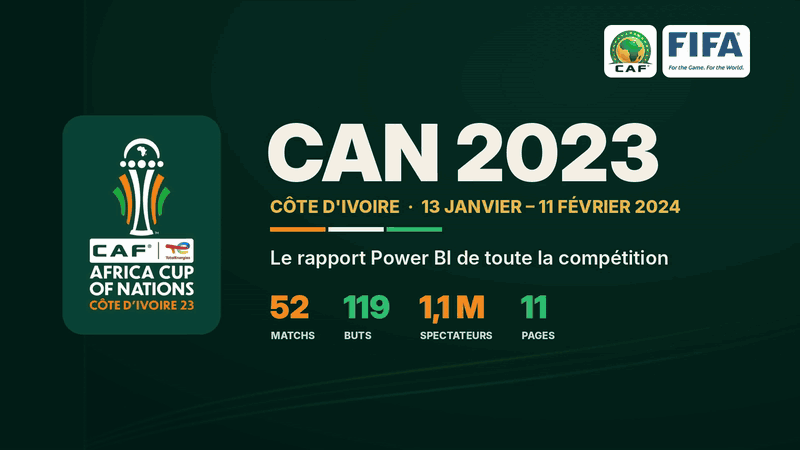
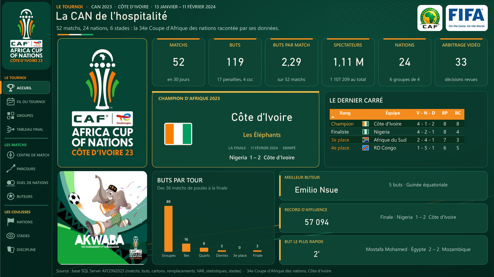
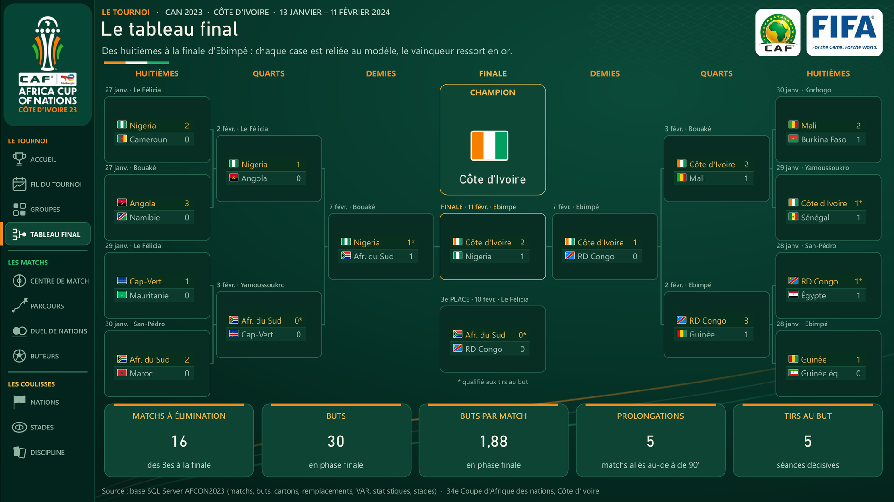
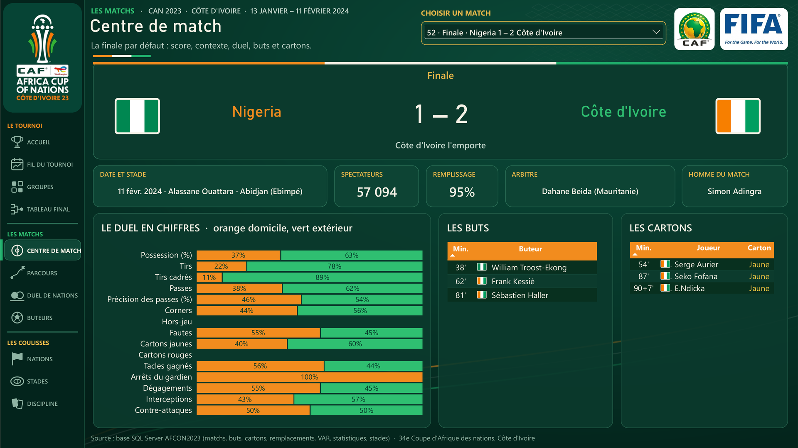
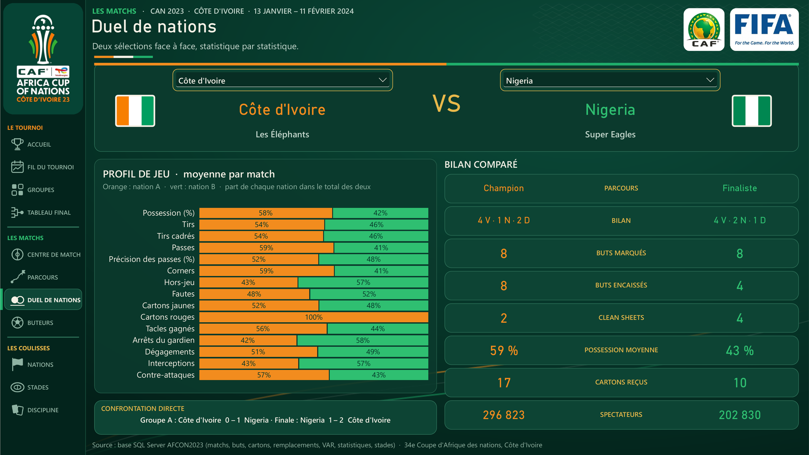
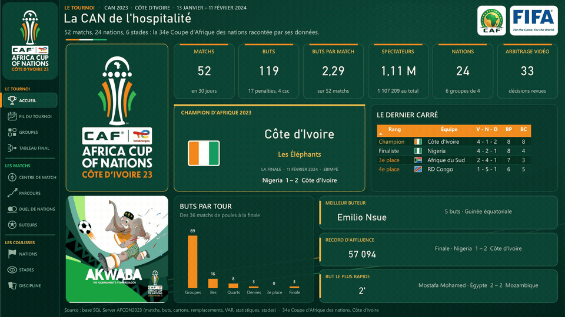
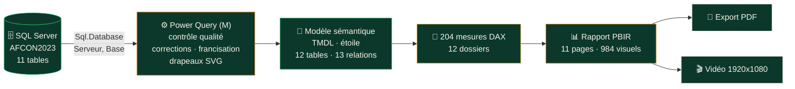
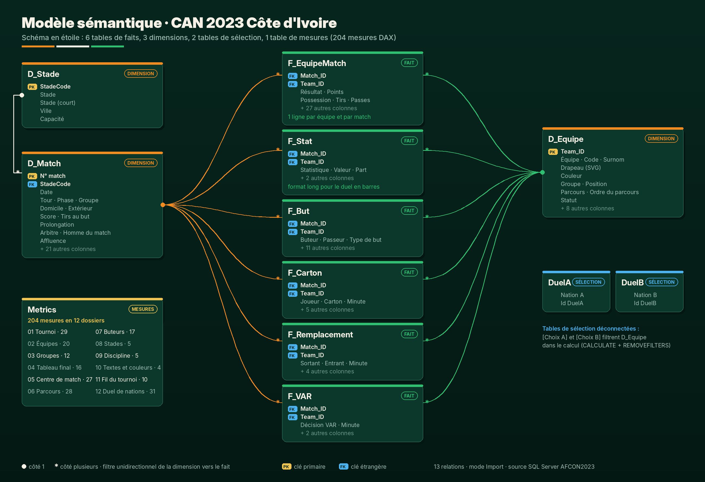

<div align="center">

# 🏆 CAN 2023 Côte d'Ivoire · Rapport Power BI

### La 34e Coupe d'Afrique des nations racontée par ses données, en 11 pages interactives

**52 matchs · 119 buts · 24 nations · 6 stades · 1 107 209 spectateurs · 30 jours de football**

[](#-stack-technique)
[](sql/schema-source.sql)
[](docs/mesures.md)
[](docs/modele-semantique.md#power-query--ce-que-la-transformation-corrige-et-enrichit)
[](powerbi/CAN%202023.SemanticModel/definition)

<br>



<sub>🎬 Vidéo complète (1 min 20, 1920x1080) : <a href="docs/video/CAN2023_video_1920x1080.mp4">docs/video/CAN2023_video_1920x1080.mp4</a> · 📄 Rapport complet en PDF : <a href="docs/CAN_2023_rapport.pdf">docs/CAN_2023_rapport.pdf</a></sub>

</div>

---

## 📑 Sommaire

- [🖥️ Aperçu du dashboard](#️-aperçu-du-dashboard)
- [📊 Résultats clés](#-résultats-clés)
- [🎯 Ce que le rapport apporte](#-ce-que-le-rapport-apporte)
- [📋 Résumé exécutif](#-résumé-exécutif)
- [🧭 Les 11 pages](#-les-11-pages)
- [🔄 Pipeline](#-pipeline)
- [🧬 Lignage des données](#-lignage-des-données)
- [🏗️ Architecture et modèle sémantique](#️-architecture-et-modèle-sémantique)
- [🛠️ Stack technique](#️-stack-technique)
- [🚀 Ouvrir le projet](#-ouvrir-le-projet)
- [🔒 Données](#-données)
- [📁 Structure du dépôt](#-structure-du-dépôt)
- [✅ Conclusion](#-conclusion)
- [💡 Le mot de la fin](#-le-mot-de-la-fin)

---

## 🖥️ Aperçu du dashboard

<table>
<tr>
<td width="50%"><br><sub><b>01 · Accueil</b> : la compétition en une page</sub></td>
<td width="50%"><br><sub><b>04 · Tableau final</b> : des huitièmes à la finale d'Ebimpé</sub></td>
</tr>
<tr>
<td width="50%"><br><sub><b>05 · Centre de match</b> : les 52 matchs, un clic chacun</sub></td>
<td width="50%"><br><sub><b>07 · Duel de nations</b> : deux sélections face à face</sub></td>
</tr>
</table>

<div align="center">

**Les 11 pages en mouvement**



**Centre de match et Parcours, filmés dans la vidéo**


</div>

---

## 📊 Résultats clés

| 🏟️ Le tournoi | ⚽ Le jeu | 🟨 Les coulisses |
|---|---|---|
| **52** matchs en **30 jours** (13 janvier au 11 février 2024) | **119** buts, **2,29** par match | **171** cartons jaunes, **13** rouges |
| **24** nations, **6** groupes, **16** qualifiées | **81** buteurs différents | **33** interventions de la VAR |
| **6** stades dans **5** villes | **17** penalties transformés | **463** remplacements |
| **1 107 209** spectateurs, **21 292** de moyenne | **19** buts dans le temps additionnel | **5** prolongations, **5** séances de tirs au but |
| Record : **57 094** pour la finale à Ebimpé | **62 %** des buts sur passe décisive | Fenêtre la plus chaude : **76e à 90e** (32 buts, 57 cartons) |

### 🔎 Ce que les données révèlent

- 🇨🇮 **Le champion venu de nulle part.** La Côte d'Ivoire perd deux matchs de poule (0-1 contre le Nigeria, 0-4 contre la Guinée équatoriale), se qualifie comme **quatrième et dernier meilleur troisième**, puis élimine le Sénégal, le Mali, la RD Congo et bat le Nigeria **2-1** en finale. Bilan final : 4 V · 1 N · 2 D, 8 buts marqués, 8 encaissés. Le rapport le montre page *Groupes* (course des troisièmes) puis page *Parcours*.
- ⏱️ **Un tournoi qui se décide tard.** 32 buts entre la 76e et la 90e minute, le but le plus tardif à la **120+2'** (Oumar Diakité, Côte d'Ivoire contre Mali), le plus rapide à la **2e minute** (Mostafa Mohamed, Égypte contre Mozambique).
- 📉 **Deux compétitions en une.** 2,47 buts par match en poules, 1,88 en élimination directe : l'enjeu ferme le jeu.
- 🏟️ **Des tribunes qui suivent l'enjeu.** Affluence moyenne de 18 559 en poules, 41 124 en demi-finales, 57 094 en finale.
- 🥇 **Emilio Nsue** termine meilleur buteur avec **5 buts** pour la Guinée équatoriale.

---

## 🎯 Ce que le rapport apporte

| Pour qui | Ce qu'il y trouve |
|---|---|
| 📺 **Médias et diffuseurs** | Les récits du tournoi prêts à l'antenne : records, tournants, profils de nations, duels. |
| 🏛️ **Organisateurs et fédérations** | Affluence et remplissage par stade et par tour, discipline, arbitrage vidéo, charge des arbitres. |
| 🧠 **Analystes et staffs techniques** | Profils de jeu comparés à la moyenne du tournoi, duels statistique par statistique, minutes décisives. |
| ❤️ **Supporters** | Le parcours de leur équipe match par match, ses buteurs et le tableau final complet. |

Le rapport transforme onze tables brutes en une expérience de lecture : **un fait par visuel, une question par page, une histoire du premier au dernier écran.**

---

## 📋 Résumé exécutif

Ce projet est un **rapport Power BI de bout en bout** sur la CAN 2023 disputée en Côte d'Ivoire. Il part d'une base **SQL Server** (`AFCON2023`, 11 tables), nettoie et enrichit les données en **Power Query**, les organise dans un **modèle sémantique en étoile** de 12 tables et 13 relations, calcule **204 mesures DAX**, et les met en scène dans **11 pages** et **984 visuels**.

Il est livré au format **PBIP** (Power BI Project) : le modèle est en **TMDL** et le rapport en **PBIR**, deux formats texte lisibles, versionnables et comparables ligne à ligne dans Git.

**Ce qui le distingue :**

- 🎨 **Une identité visuelle propre à la compétition** : vert profond, orange, ivoire et vert de la Côte d'Ivoire, logo officiel toujours visible, logos CAF et FIFA, mascotte Akwaba et photo du stade d'Ebimpé.
- 🏳️ **24 drapeaux dessinés en SVG** et stockés dans le modèle : chaque tableau affiche un drapeau devant chaque nation, sans aucune image externe.
- 🧭 **Une navigation d'application** : un rail fixe à gauche, trois actes (le tournoi, les matchs, les coulisses), une icône active par page.
- 🗂️ **Un vrai tableau à élimination directe** construit dans Power BI, relié au modèle.
- 🔁 **Trois pages pilotées par l'utilisateur** : n'importe quel match, n'importe quelle nation, n'importe quel duel, avec des valeurs par défaut qui racontent déjà l'histoire (la finale, le champion, Côte d'Ivoire contre Nigeria).
- 🧹 **Un contrôle qualité des données documenté** : buts et cartons rattachés au mauvais match, dates décalées, statuts incohérents, tout est corrigé en Power Query et expliqué.
- ✅ **Zéro texte rogné, zéro barre de défilement** : chaque tableau est dimensionné pour afficher toutes ses lignes, chaque carte pour sa valeur.

---

## 🧭 Les 11 pages

| # | Page | La question à laquelle elle répond |
|---|---|---|
| 01 | 🏆 **Accueil** | Que faut-il retenir de cette CAN en un écran ? |
| 02 | 📅 **Le fil du tournoi** | Comment le tournoi a-t-il vécu, jour après jour ? |
| 03 | 🔢 **Les six groupes** | Qui s'est qualifié, et comment se sont joués les repêchages ? |
| 04 | 🌳 **Le tableau final** | Quel chemin mène des huitièmes au titre ? |
| 05 | 🎯 **Centre de match** | Que s'est-il passé dans ce match précis ? |
| 06 | 🧭 **Parcours d'une nation** | Quel a été le chemin et le style de cette équipe ? |
| 07 | ⚔️ **Duel de nations** | Qui domine, statistique par statistique ? |
| 08 | ⚽ **Les buteurs** | Qui a marqué, quand et comment ? |
| 09 | 🌍 **Les 24 nations** | Quel est le classement final et le profil de chaque équipe ? |
| 10 | 🏟️ **Stades et affluence** | Qui a rempli les tribunes ? |
| 11 | 🟥 **Discipline et VAR** | Quelle est la face cachée de l'arbitrage ? |

📖 Description détaillée de chaque page avec sa capture : **[docs/pages.md](docs/pages.md)**

---

## 🔄 Pipeline



---

## 🧬 Lignage des données

| Table source (`dbo`) | Transformation Power Query | Table du modèle |
|---|---|---|
| `Matches` + `Stadiums` | dates recalées, tours francisés, score, tirs au but, prolongation, vainqueur, affluence | `D_Match` |
| `Teams` + `Groups` | noms français, code FIFA, surnom, couleur, drapeau SVG, parcours et statut dérivés | `D_Equipe` |
| (référentiel) | 6 stades, villes, capacités | `D_Stade` |
| `Matches` + `StatisticsKeys` + `Defenses` | dépliage domicile / extérieur en 2 lignes par match | `F_EquipeMatch` |
| `StatisticsKeys` + `Defenses` | format long statistique, valeur, part | `F_Stat` |
| `Goals` | buts recalés sur le bon match, minute et temps additionnel, tranches, types | `F_But` |
| `YellowCards` + `RedCards` | réunion, cartons réaffectés au bon match, minutes, tranches | `F_Carton` |
| `Substitutions` | période (réglementaire, additionnel, prolongation) | `F_Remplacement` |
| `Vars` | décisions traduites | `F_VAR` |
| `D_Equipe` (DAX) | `SELECTCOLUMNS` | `DuelA`, `DuelB` |

---

## 🏗️ Architecture et modèle sémantique



- ⭐ **Schéma en étoile** : deux dimensions conformes (`D_Match`, `D_Equipe`) partagées par six tables de faits, `D_Stade` en flocon sous `D_Match`.
- ➡️ **13 relations un-à-plusieurs**, filtre unidirectionnel de la dimension vers le fait : pas de relation bidirectionnelle, pas d'ambiguïté.
- 🔌 **Deux tables de sélection déconnectées** pour comparer deux nations sans dupliquer le modèle.
- 📐 **Une table de mesures** de 204 mesures en 12 dossiers, un par page.

📖 Documentation complète (tables, grain, colonnes, Power Query, choix DAX, diagramme Mermaid) : **[docs/modele-semantique.md](docs/modele-semantique.md)**
📐 Catalogue des 204 mesures avec leur code DAX : **[docs/mesures.md](docs/mesures.md)**

### Quelques mesures représentatives

```dax
-- Classement final des 24 nations : parcours, puis points, puis différence de buts
Rang final =
IF ( HASONEVALUE ( D_Equipe[Team_ID] ),
     RANKX ( ALL ( D_Equipe ), [Clé de classement], , ASC, Dense ) )

-- Top 8 des affluences, utilisé comme filtre de visuel
Rang affluence =
IF ( HASONEVALUE ( D_Match[N° match] ),
     RANKX ( ALL ( D_Match ), CALCULATE ( SUM ( D_Match[Affluence] ) ), , DESC ) )

-- Duel de nations : la nation A choisie dans une table déconnectée (Côte d'Ivoire par défaut)
Choix A = SELECTEDVALUE ( DuelA[Id DuelA], 3 )

DA Buts marqués =
VAR t = [Choix A]
RETURN CALCULATE ( [Buts marqués], REMOVEFILTERS ( D_Equipe ), D_Equipe[Team_ID] = t )

-- Taux de remplissage des stades
Taux de remplissage = DIVIDE ( [Spectateurs], [Capacité offerte] )
```

---

## 🛠️ Stack technique

| Couche | Outil | Usage |
|---|---|---|
| 🗄️ Stockage | **SQL Server 2022** | Base `AFCON2023`, 11 tables, schéma `dbo` |
| ⚙️ Transformation | **Power Query (M)** | Contrôle qualité, corrections, francisation, dépliage, drapeaux SVG |
| 🧬 Modélisation | **Power BI · TMDL** | Schéma en étoile, relations, tables calculées, paramètres |
| 📐 Calcul | **DAX** | 204 mesures, classements `RANKX`, tables de sélection, textes dynamiques |
| 📊 Restitution | **Power BI · PBIR** | 11 pages, 984 visuels, thème personnalisé, navigation par boutons |
| 🔀 Versionnement | **Git · PBIP** | Projet entièrement en texte, diffable et relisible |
| 🎬 Diffusion | **PDF · vidéo 1920x1080** | Export du rapport et vidéo de présentation |

---

## 🚀 Ouvrir le projet

**Prérequis :** Power BI Desktop (version récente, avec l'option *Enregistrer au format Power BI Project (.pbip)*) et une instance SQL Server.

1. **Créer la base source** : exécutez [`sql/schema-source.sql`](sql/schema-source.sql) dans SSMS. Le script crée la base `AFCON2023` et ses 11 tables vides.
2. **Charger vos données** dans ces tables (voir [🔒 Données](#-données)).
3. **Cloner le dépôt** :
   ```bash
   git clone https://github.com/abdoulhamiddiallo/can-2023-afcon-powerbi.git
   ```
4. **Ouvrir** `powerbi/CAN 2023.pbip` dans Power BI Desktop.
5. **Renseigner la source** : *Transformer les données* → *Modifier les paramètres* → `Serveur` = votre instance (par défaut `localhost`), `Base` = `AFCON2023`.
6. **Actualiser** : les 11 pages se remplissent.

---

## 🔒 Données

> **Ce dépôt ne publie aucune donnée.**

Le projet est livré **sans les lignes de la base** : pas de fichier CSV, pas de sauvegarde SQL, pas de cache Power BI (`.pbi/cache.abf` est exclu par le `.gitignore`). Le modèle ne contient que sa **structure** (tables, colonnes, relations, transformations, mesures), et le rapport ne contient que sa **mise en page**.

Ce qui est fourni pour reconstruire l'ensemble :

- 🧱 la **structure exacte** de la source : [`sql/schema-source.sql`](sql/schema-source.sql) ;
- ⚙️ toutes les **transformations Power Query**, dans les partitions TMDL de [`powerbi/CAN 2023.SemanticModel`](powerbi/CAN%202023.SemanticModel/definition/tables) ;
- 📄 le **rendu final** du rapport en [PDF](docs/CAN_2023_rapport.pdf), en captures et en vidéo.

---

## 📁 Structure du dépôt

```
can-2023-afcon-powerbi/
├── 📄 README.md
├── 🗂️ powerbi/
│   ├── CAN 2023.pbip                      ← point d'entrée Power BI Desktop
│   ├── CAN 2023.SemanticModel/            ← modèle sémantique (TMDL)
│   │   └── definition/
│   │       ├── model.tmdl · database.tmdl
│   │       ├── expressions.tmdl           ← paramètres Serveur et Base
│   │       ├── relationships.tmdl         ← 13 relations
│   │       └── tables/                    ← 12 tables, Power Query et 204 mesures
│   └── CAN 2023.Report/                   ← rapport (PBIR)
│       ├── definition/pages/              ← 11 pages, 984 visuels
│       └── StaticResources/               ← thème, logos, icônes, fond
├── 🗄️ sql/
│   └── schema-source.sql                  ← structure de la base, sans données
└── 📚 docs/
    ├── pages.md                           ← les 11 pages expliquées
    ├── modele-semantique.md               ← le modèle en détail
    ├── mesures.md                         ← les 204 mesures DAX
    ├── modele-semantique.png              ← diagramme du modèle
    ├── CAN_2023_rapport.pdf               ← export complet du rapport
    ├── pages/                             ← 11 captures 1920x1080
    ├── gifs/                              ← aperçus animés
    └── video/                             ← vidéo de présentation 1920x1080
```

---

## ✅ Conclusion

Ce rapport montre qu'une compétition sportive se raconte mieux qu'elle ne se résume. De la base SQL Server au dernier pixel, chaque étape est maîtrisée : des données corrigées et documentées, un modèle en étoile sans ambiguïté, des mesures lisibles, et une mise en scène qui guide le regard de l'accueil jusqu'aux coulisses.

La CAN 2023 restera celle d'un pays hôte qui a failli sortir dès les poules et qui a fini par soulever le trophée à Ebimpé. Ce rapport permet de revivre ce scénario, match après match, chiffre après chiffre.

---

## 💡 Le mot de la fin

> **Construire pour explorer. Explorer pour comprendre. Et apprendre en chemin.**

<div align="center">

**Abdoul Hamid Diallo** · Power BI · SQL Server · Microsoft Fabric

[](https://www.linkedin.com/in/abdoul-hamid-diallo-fabric-data-engineer/)
[](https://github.com/abdoulhamiddiallo)

<sub>Les logos de la CAN, de la CAF et de la FIFA ainsi que la mascotte Akwaba appartiennent à leurs détenteurs respectifs et sont utilisés ici à titre illustratif, dans un projet personnel non commercial.</sub>

</div>
