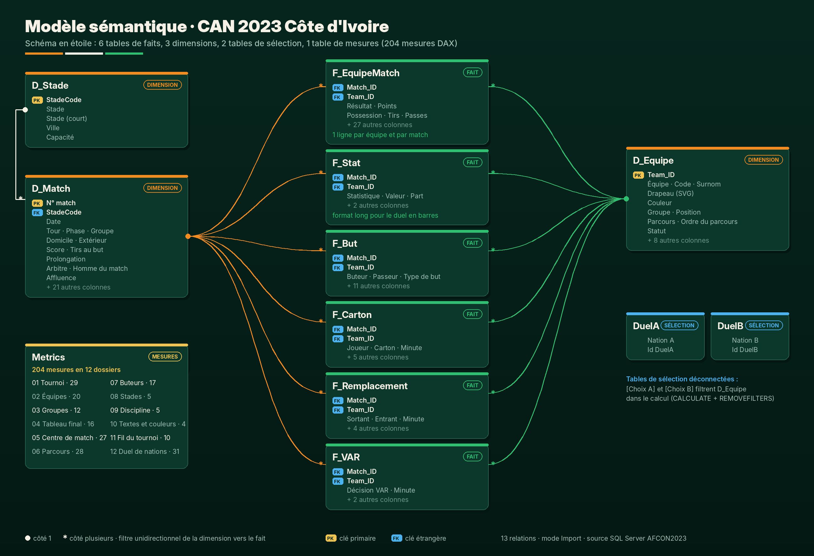
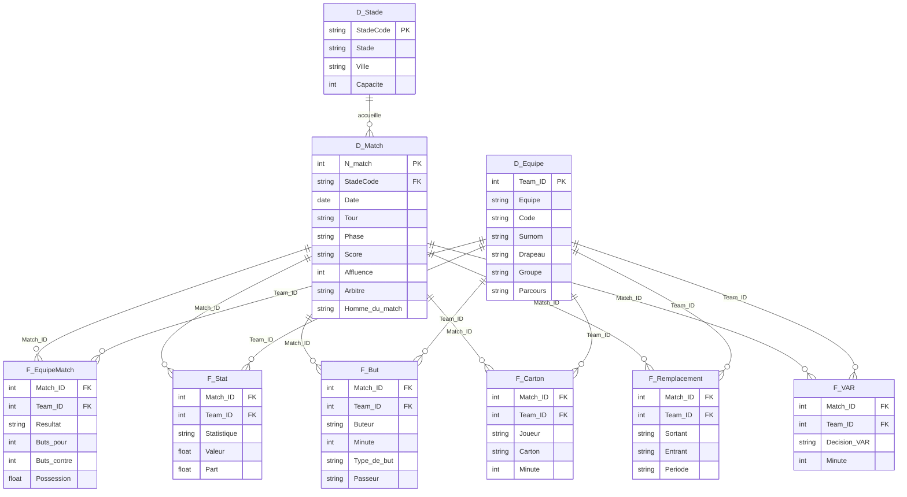

# Le modèle sémantique

> Un schéma en étoile propre, écrit en TMDL, alimenté par Power Query depuis SQL Server, et pensé pour que chaque visuel du rapport soit une mesure simple à lire.

## En un coup d'œil

| Élément | Valeur |
|---|---|
| Format | Projet Power BI **PBIP**, modèle en **TMDL**, rapport en **PBIR** |
| Mode de stockage | Import |
| Source | SQL Server, base `AFCON2023`, schéma `dbo` (11 tables) |
| Paramètres Power Query | `Serveur` (instance SQL Server) et `Base` (nom de la base) |
| Tables du modèle | 12 : 3 dimensions, 6 faits, 2 tables de sélection, 1 table de mesures |
| Relations | 13, toutes en un-à-plusieurs, filtre unidirectionnel |
| Mesures DAX | 204, rangées en 12 dossiers ([catalogue complet](mesures.md)) |
| Culture | `fr-FR` (dates, séparateurs, libellés) |

## Diagramme relationnel

## Les tables

### Dimensions

| Table | Grain | Rôle |
|---|---|---|
| `D_Match` | 1 ligne par match (52) | Calendrier, tour, phase, affiche, score, tirs au but, prolongation, vainqueur, arbitre, homme du match, stade, affluence. Colonnes de tri dédiées (`Ordre du tour`) pour que les axes suivent la chronologie de la compétition. |
| `D_Equipe` | 1 ligne par nation (24) | Nom français, nom court, code FIFA, surnom (« Les Éléphants », « Super Eagles »…), couleur, **drapeau en SVG** (URL `data:image`, catégorie *Image URL*), groupe, position, parcours final et son ordre. |
| `D_Stade` | 1 ligne par stade (6) | Nom complet, nom court, ville et capacité, pour calculer le taux de remplissage. |

### Faits

| Table | Grain | Ce qu'elle permet |
|---|---|---|
| `F_EquipeMatch` | 1 ligne par équipe et par match | Le cœur du modèle : la source large `Matches` + `StatisticsKeys` + `Defenses` est **dépliée en deux lignes par match** (domicile et extérieur) pour obtenir victoires, nuls, défaites, points, clean sheets et 15 statistiques de jeu sans aucun `IF` côté visuel. |
| `F_Stat` | 1 ligne par équipe, match et statistique | La même information en **format long** (`Statistique`, `Valeur`, `Part`), qui alimente les barres 100 % du duel en chiffres et du duel de nations. |
| `F_But` | 1 ligne par but (119) | Buteur, minute réelle et temps additionnel (`90+7'`), tranche de 15 minutes, type de but, poste, passeur. |
| `F_Carton` | 1 ligne par carton | Jaunes et rouges réunis en une seule table, avec minute et tranche. |
| `F_Remplacement` | 1 ligne par changement | Sortant, entrant, postes, minute et période (temps réglementaire, temps additionnel, prolongation). |
| `F_VAR` | 1 ligne par intervention | Décision de l'arbitrage vidéo traduite (penalty accordé, but refusé…). |

### Tables de sélection et mesures

| Table | Rôle |
|---|---|
| `DuelA`, `DuelB` | Tables calculées **déconnectées** (`SELECTCOLUMNS` sur `D_Equipe`). Elles portent les deux listes déroulantes de la page *Duel de nations* : `[Choix A]` et `[Choix B]` lisent la sélection et chaque mesure `DA …` / `DB …` réapplique le filtre sur `D_Equipe` avec `CALCULATE` + `REMOVEFILTERS`. Deux nations comparées côte à côte sans dupliquer le modèle. |
| `Metrics` | Table de mesures sans colonne : les 204 mesures du rapport, classées par page. |

## Power Query : ce que la transformation corrige et enrichit

Toute la préparation se fait en M, dans chaque partition, à partir des tables brutes `dbo.*`. Aucune vue SQL n'est nécessaire.

1. **Paramétrage de la source** : `Sql.Database(Serveur, Base)`. Changer d'instance revient à modifier un seul paramètre.
2. **Contrôle qualité et corrections de cohérence** relevées en croisant les tables :
   - les buts des matchs 27 à 33 étaient rattachés au match suivant : ils sont recalés d'un rang ;
   - des cartons jaunes enregistrés sur la finale appartenaient à la demi-finale précédente de la même équipe : ils sont réaffectés ;
   - les dates sont recalées sur le calendrier réel du tournoi, joué du **13 janvier au 11 février 2024** ;
   - le statut « qualifiée / éliminée » est **dérivé du parcours final** plutôt que lu tel quel, ce qui supprime une incohérence de la source ;
   - les prolongations sont détectées à partir des **changements effectués en prolongation**, la seule information fiable de la source.
3. **Minutes de football** : `Minute_Format` (temps additionnel, prolongation) est converti en minute de base + minutes ajoutées, ce qui donne `45+2'`, `90+7'`, `120+2'`, une clé de tri exacte et des tranches de 15 minutes (`0-15'` à `91-120'`).
4. **Francisation complète** : nations, tours (`8es de finale`, `Quarts`, `Demies`), parcours, postes, types de but, décisions VAR et pays des arbitres.
5. **Enrichissement visuel** : code FIFA, surnom, couleur et **drapeau dessiné en SVG** pour chacune des 24 nations, intégrés au modèle pour que les tableaux affichent un drapeau devant chaque pays sans aucune image externe.
6. **Dépliage domicile / extérieur** des statistiques larges (`Shots1`, `Shots2`…) en lignes par équipe, puis en format long pour `F_Stat`.

## Choix de conception DAX

- **Une mesure, une question** : `[Buts par match] = DIVIDE ( [Buts], [Matchs] )`. Les mesures de base (`Matchs`, `Buts`, `Spectateurs`, `Victoires`…) sont réutilisées partout.
- **Préfixes par page** : `MC` pour le Centre de match, `PC` pour le Parcours, `DA` / `DB` pour le Duel. Le dossier d'affichage reprend le numéro de la page.
- **Classements robustes** : `RANKX` sur `ALL ( … )` pour le rang final, le rang des troisièmes, le top 8 des affluences ou le top 12 des sanctions, utilisés comme filtres de visuel plutôt que des Top N figés.
- **Valeurs par défaut pensées pour l'histoire** : la finale est le match affiché par défaut, la Côte d'Ivoire la nation par défaut, Côte d'Ivoire contre Nigeria le duel par défaut.
- **Mesures de texte** pour les sous-titres dynamiques (« Côte d'Ivoire l'emporte », « 4 V · 1 N · 2 D ») et **mesures de couleur** pour la mise en forme conditionnelle.
