# Les 11 pages du rapport

Le rapport se lit comme un récit en trois actes, rangés dans le rail de navigation à gauche de chaque page :

| Acte | Pages |
|---|---|
| **Le tournoi** | Accueil · Fil du tournoi · Groupes · Tableau final |
| **Les matchs** | Centre de match · Parcours · Duel de nations · Buteurs |
| **Les coulisses** | Nations · Stades · Discipline et VAR |

Chaque page suit la même grammaire : un sur-titre de section, un titre éditorial, une phrase qui dit ce que la page raconte, une rangée d'indicateurs clés, puis les visuels d'analyse. Le logo officiel de la compétition reste visible en permanence dans le rail, les logos CAF et FIFA en haut à droite.

---

## 01 · Accueil : « La CAN de l'hospitalité »

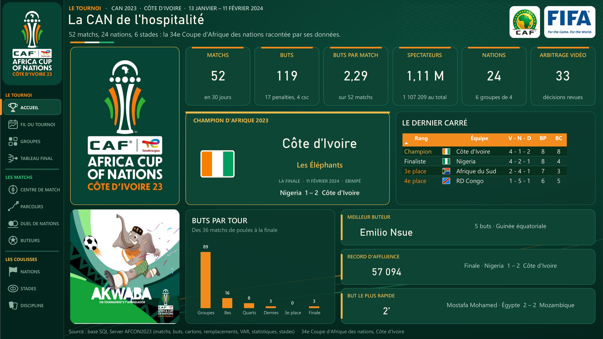

La compétition en une page : 52 matchs, 119 buts, 2,29 buts par match, 1,11 million de spectateurs, 24 nations, 33 décisions VAR. Au centre, le champion d'Afrique 2023 et sa finale ; à droite, le dernier carré ; en bas, les buts par tour et trois records (meilleur buteur, record d'affluence, but le plus rapide).

## 02 · Le fil du tournoi

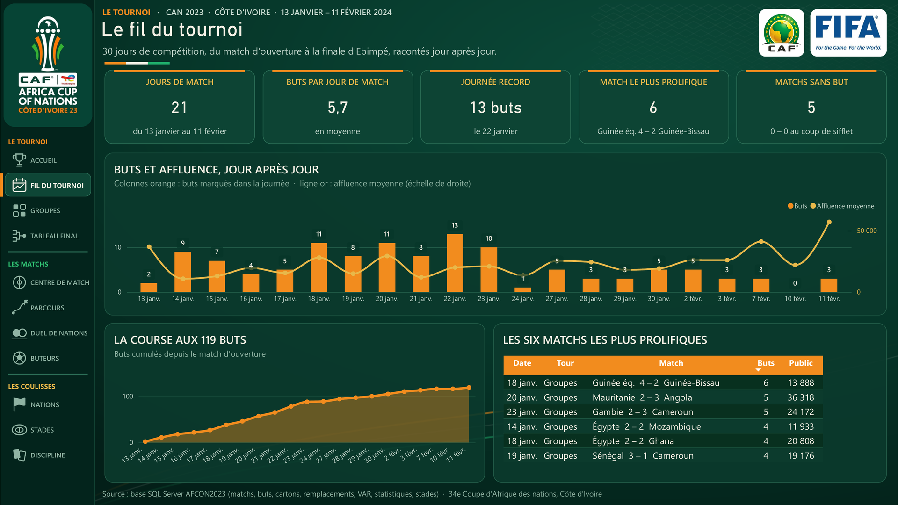

Les 30 jours de compétition racontés jour après jour : buts et affluence moyenne sur un même axe temporel, la course aux 119 buts en cumul, la journée record (13 buts le 22 janvier) et les six matchs les plus prolifiques.

## 03 · Les six groupes

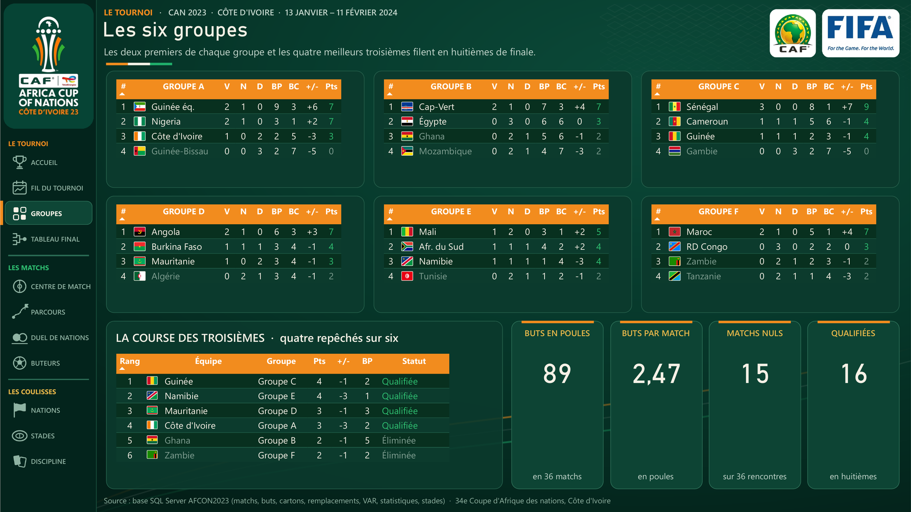

Les six classements de poules avec drapeaux, bilan et différence de buts, et surtout **la course des troisièmes** : quatre repêchés sur six. C'est là que se joue l'histoire du champion, qualifié en huitièmes comme quatrième meilleur troisième.

## 04 · Le tableau final

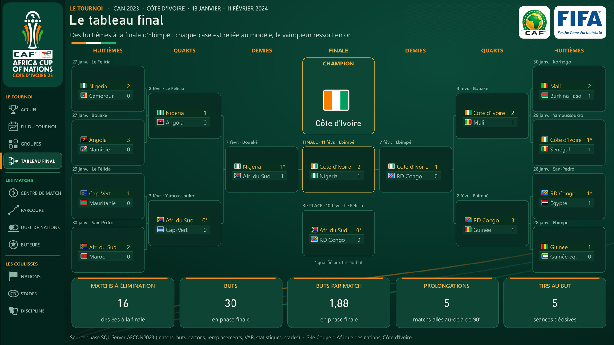

Un vrai tableau à élimination directe dessiné dans Power BI : des huitièmes à la finale d'Ebimpé, chaque case est liée au modèle, le vainqueur ressort en or, les qualifications aux tirs au but sont marquées d'un astérisque. Sous le tableau : 16 matchs à élimination, 30 buts, 5 prolongations, 5 séances de tirs au but.

## 05 · Centre de match

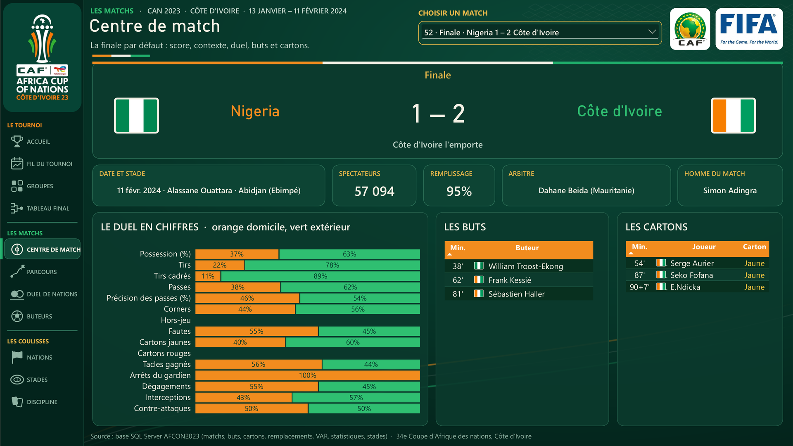

Un match au choix parmi les 52, la finale par défaut. Score, issue rédigée automatiquement, date, stade, affluence, remplissage, arbitre, homme du match, le duel statistique en barres 100 % (orange domicile, vert extérieur), les buts et les cartons minute par minute.

## 06 · Parcours d'une nation

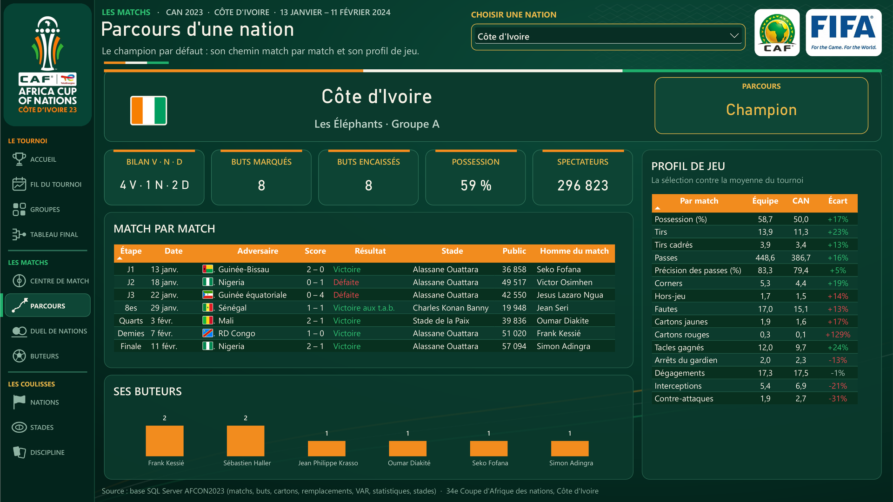

Une nation au choix, le champion par défaut : bilan, buts, possession, spectateurs, chaque match avec étape, adversaire, score, stade et homme du match, ses buteurs, et un **profil de jeu** qui compare l'équipe à la moyenne du tournoi avec un écart coloré.

## 07 · Duel de nations

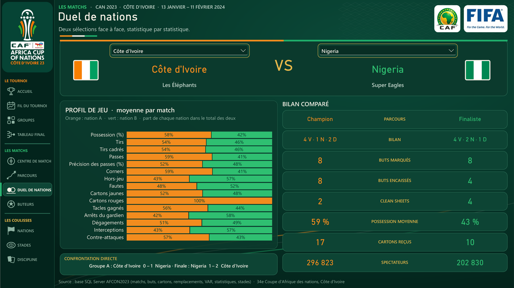

Deux sélections face à face, choisies dans deux listes indépendantes. Le profil de jeu en parts relatives, le bilan comparé ligne à ligne et la confrontation directe pendant la compétition.

## 08 · Les buteurs

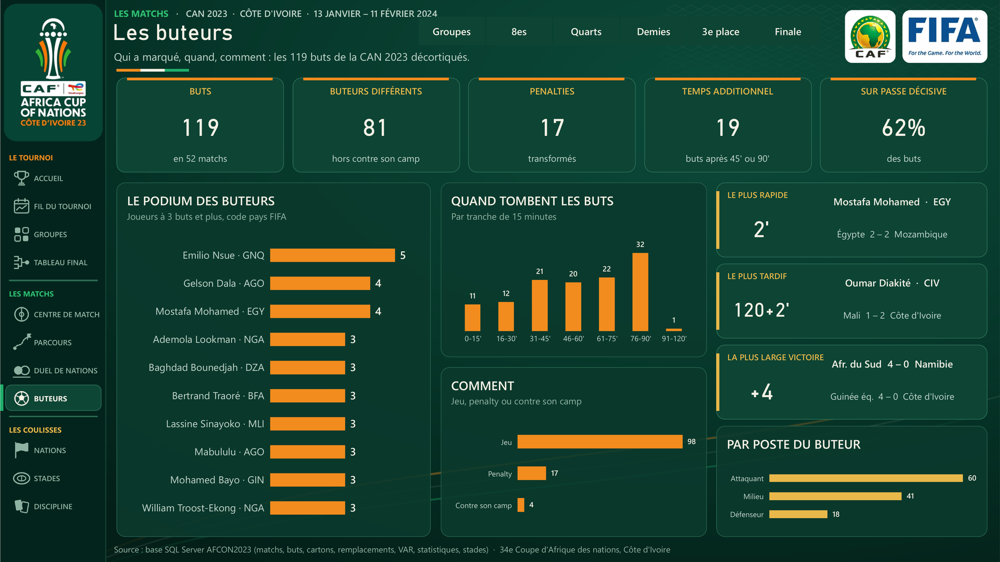

Qui a marqué, quand et comment : 81 buteurs différents, 17 penalties, 19 buts dans le temps additionnel, 62 % de buts sur passe décisive. Le podium des buteurs, les buts par tranche de 15 minutes, le plus rapide, le plus tardif, la plus large victoire et la répartition par poste. Les tours se filtrent en un clic.

## 09 · Les 24 nations

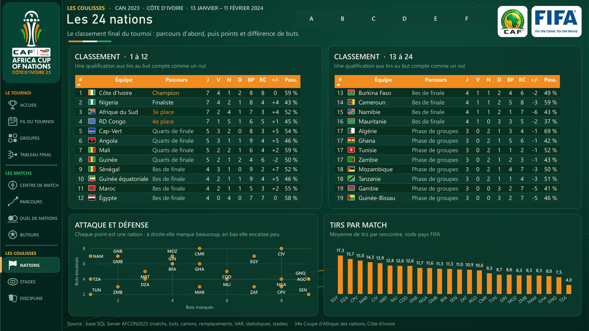

Le classement final complet des 24 nations, ordonné par parcours puis par points et différence de buts, une carte attaque et défense en nuage de points et le volume de tirs par match. Filtrable par groupe.

## 10 · Stades et affluence

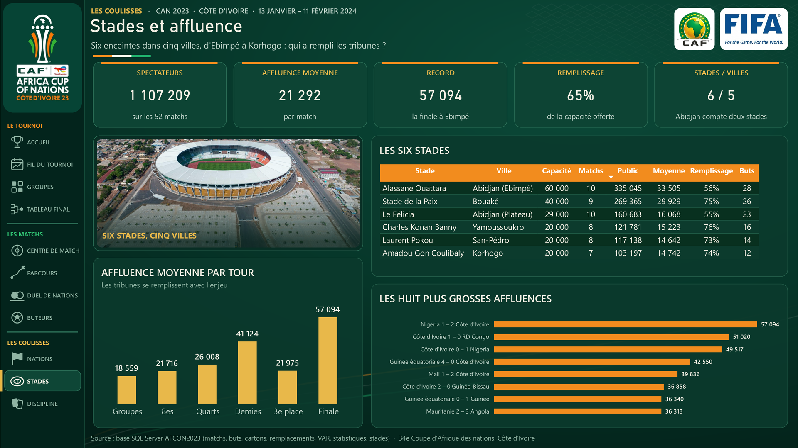

Six enceintes dans cinq villes : spectateurs, affluence moyenne, record, taux de remplissage. Le tableau des six stades, l'affluence par tour qui monte avec l'enjeu et les huit plus grosses affluences.

## 11 · Discipline et VAR

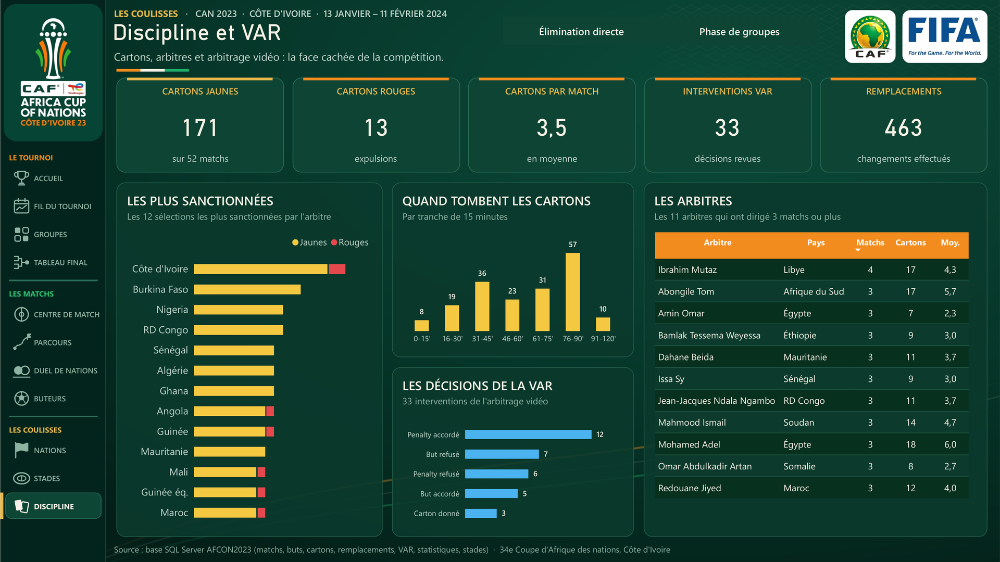

La face cachée de la compétition : cartons jaunes et rouges, sélections les plus sanctionnées, minutes où tombent les cartons, décisions de l'arbitrage vidéo et les arbitres qui ont dirigé au moins trois matchs. Filtrable entre phase de groupes et élimination directe.
